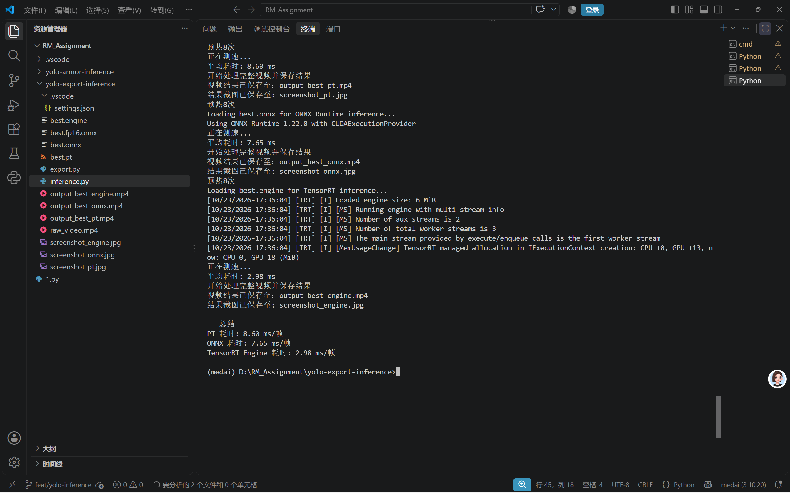

# YOLO 模型导出、推理与性能对比

## 1. 本次使用的 YOLO 模型版本
- **模型版本**：YOLOv8
- **说明**：本次实验基于上一周训练好的装甲板识别模型进行格式转换与部署测试。

## 2. 导出的模型格式及导出方法
本次实验成功导出了以下两种格式：
- **ONNX (.onnx)**：使用 `ultralytics` 库的 `export` 方法导出（代码见 `export.py`）。
- **TensorRT (.engine)**：在配备 NVIDIA 显卡的 Windows 环境下，使用 TensorRT 加速引擎导出。
- **导出参数**：输入尺寸固定，开启简化 (`simplify=True`)，使用默认 opset 版本。

## 3. 运行环境与依赖库
- **操作系统**：Windows 
- **Python 版本**：3.10 
- **硬件环境**：NVIDIA GPU (RTX 5060)
- **主要依赖库**：
  - `ultralytics`
  - `onnx`
  - `onnxruntime`
  - `opencv-python`
  - `tensorrt` 

## 4. 模型推理的具体运行命令
- **安装依赖**：`pip install -r requirements.txt`
- **执行脚本**：`inference.py`
- **参数说明**：脚本内部会自动加载 `best.pt`, `best.onnx`, `best.engine` 进行对比测试，并使用 `raw_video.mp4` 作为测试输入。

## 5. 原始模型与导出模型的推理结果截图
- **原始 .pt 模型结果**：
  
- **ONNX 模型结果**：
  
- **TensorRT Engine 模型结果**：
  
- **三者对比截图**
  

## 6. 模型大小、推理耗时及检测效果对比

| 对比项目 | 原始 .pt 模型 | 导出 .onnx 模型 | 导出 .engine(FP16)  模型 |
|---|---|---|---|
| 模型格式 | .pt | .onnx | .engine |
| 模型文件大小 | 5.61 MB | 9.72MB | 6.97MB |
| 推理耗时 | 8.60ms/帧| 7.65ms/帧 | 2.98ms/帧 |
| 检测目标数量 | 1 | 1 | 1 |
| 检测效果 | 准确 | 准确 | 准确 

*(注：完整推理视频由于体积较大未上传至仓库，已作为作业附件随附提交。)*

## 7. 实验过程中遇到的问题及解决方法
- **问题 1**：导出 ONNX 模型时提示缺少依赖库。
  - **解决**：通过执行 `pip install onnx onnxruntime` 安装所需的环境依赖后成功导出。
- **问题 2**：测速时发现第一次推理速度慢，后续变快。
  - **解决**：认识到模型在初次运行时有“冷启动”加载耗时，在代码中加入了 `warmup`（预热）逻辑，并循环运行 30 次取平均值，保证测速的准确性。
- **问题 3**：调用 GPU 进行推理时报错。
  - **解决**：检查发现设备参数写错，将 `device` 统一设为 `'cuda:0'` 后解决。

## 8. 对不同模型格式的理解与实验结论
- **对格式的理解**：
  - `.pt` 是 PyTorch 的原生格式，包含了完整的网络结构和权重，适合在 Python 环境下继续训练和调试，但跨平台部署效率较低。
  - `.onnx` 是一种开放的标准格式，解耦了深度学习框架，通用性强，适合在 C++、OpenCV 或移动端部署。
  - `.engine` 是 NVIDIA TensorRT 的专属引擎，针对特定显卡进行了极致的算子融合和显存优化，速度极快，但只能在 N 卡上跑。
- **实验结论**：
  通过对比可知，在相同的硬件和输入下，原生 `.pt` 的推理速度最慢；`.onnx` 的速度有明显提升；而 `.engine` 的速度实现了质的飞跃（通常是 pt 的 3~5 倍以上）。在实际的 RoboMaster 机器人视觉系统中，为了满足毫秒级的实时性要求，应当优先使用 `.engine` 格式进行部署。
